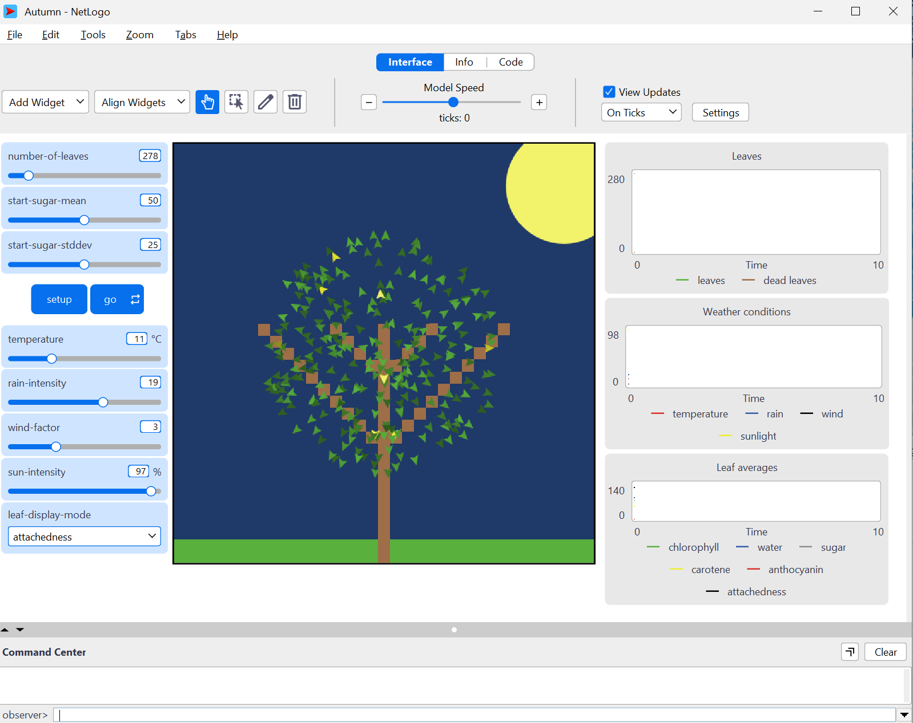
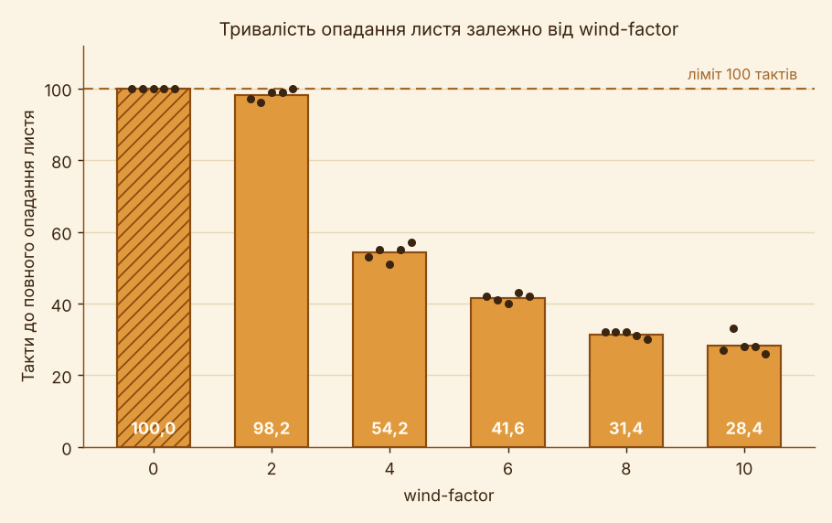
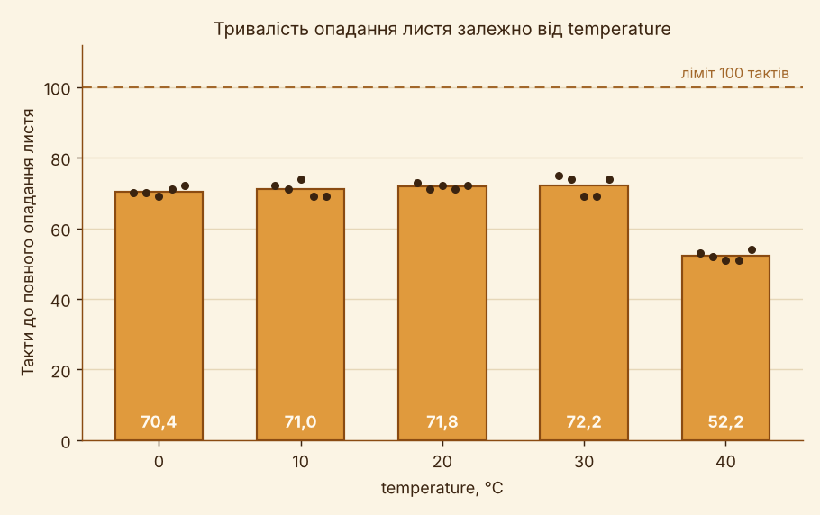
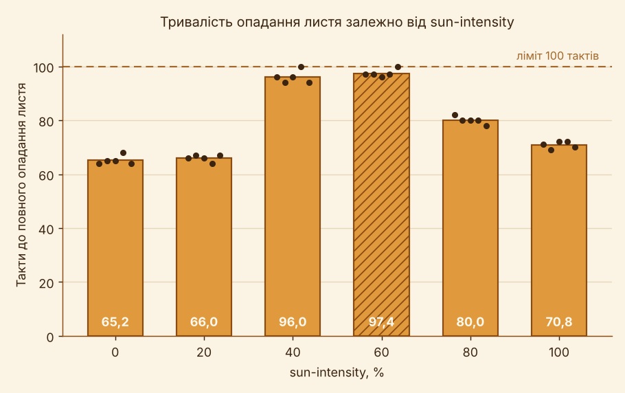

## Комп'ютерні системи імітаційного моделювання
## СПм-25-2, **Роскошний Владислав Русланович**
### Лабораторна робота №**1**. Опис імітаційних моделей та проведення обчислювальних експериментів

 

### Варіант 11, модель у середовищі NetLogo:
[Autumn](https://www.netlogoweb.org/launch#http://www.netlogoweb.org/assets/modelslib/Sample%20Models/Biology/Autumn.nlogo)

 

### Мета роботи:
Ознайомитися з моделлю Autumn з бібліотеки моделей NetLogo, описати її та провести обчислювальні експерименти, що показують характер залежності показників роботи моделі від керуючих параметрів.

### Вербальний опис моделі:
Модель Autumn з розділу Biology бібліотеки моделей NetLogo (експерименти виконано у NetLogo 7.0.4). У моделі зображено дерево з листям (за замовчуванням 278 листків), яке змінюється під впливом погодних умов: температури, дощу, вітру та сонячного світла. У ході симуляції листя змінює колір і опадає на землю. На графіку Leaves окремо показано кількість листя на дереві (leaves) та кількість опалого листя (dead leaves).  
Кожен такт (процедура go) складається з таких кроків: вітер зменшує міцність кріплення кожного листка (attachedness) на значення wind-factor і трохи повертає листок; дощ створює rain-intensity нових крапель угорі світу, які падають, потрапляють у коріння, піднімаються стовбуром і гілками до листя; кожен листок, що ще тримається на дереві, коригує вміст води, хлорофілу та цукру, після чого змінює колір і форму. Листок опадає, коли його attachedness стає не більшою за 0, а на землі перетворюється на опале листя (dead-leaves). Колір визначається співвідношенням речовин: при хлорофілі понад 50 листок зелений, інакше колір залежить від каротину (жовтий), антоціану (червоний) або їх приблизної рівності (оранжевий). Якщо температура нижча за 20, цукор і вода перетворюються на антоціан. Симуляція зупиняється, коли на дереві не лишається листя.

  
*Рис. 1. Інтерфейс моделі Autumn зі значеннями параметрів за замовчуванням.*

### Керуючі параметри:
- **number-of-leaves** - кількість листків на дереві (за замовчуванням 278).
- **start-sugar-mean** та **start-sugar-stddev** - середнє значення та стандартне відхилення початкового рівня цукру в листі (50 і 25).
- **temperature** - температура, °C (11).
- **rain-intensity** - інтенсивність дощу (19).
- **wind-factor** - коефіцієнт вітру (3).
- **sun-intensity** - інтенсивність сонячного світла, % (97).
- **leaf-display-mode** - режим відображення листя (за замовчуванням attachedness).

### Внутрішні параметри:
У експериментах використовувалися змінні листків **sugar-level** (рівень цукру) та **anthocyanin** (антоціан).  
Змінні листків (leaves-own): **water-level** (вода), **sugar-level** (цукор), **attachedness** (міцність кріплення до дерева), **chlorophyll** (хлорофіл), **carotene** (каротин), **anthocyanin** (антоціан). Змінні крапель дощу (raindrops-own): **location** (falling, in roots, in trunk або in leaves) та **amount-of-water**. Глобальні змінні: **bottom-line** (рівень землі) та **evaporation-temp** (температура випаровування води, 30). Значення змінних листків обмежуються діапазоном від 0 до 100 процедурою clip.

### Показники роботи системи:
- на графіку Leaves: кількість листя на дереві (leaves) та опалого листя (dead leaves);
- на графіку Weather conditions: температура, дощ, вітер, сонячне світло (temperature, rain, wind, sunlight);
- на графіку Leaf averages: середні значення характеристик листя - chlorophyll, water, sugar, carotene, anthocyanin, attachedness;
- кількість тактів модельного часу (ticks).

### Примітки:
Модель стохастична (початкові значення листків і рух крапель задаються випадково), тому кожний прогін дає дещо інший результат, і в експериментах значення усереднювалися за кількома прогонами. Температура, дощ, вітер і сонячне світло під час прогону не змінюються самі, їх задають слайдери.

### Недоліки моделі:
- Погодні умови постійні протягом усього прогону (немає зміни дня і ночі чи пори року), хоча в описі моделі йдеться про сезонне явище.
- Процедура go зупиняється, коли опадає все листя, тому показники наприкінці прогону мало інформативні, а важливим показником є кількість тактів до опадання листя.
- Антоціан на початку дорівнює 0 у всіх листків і не має окремого початкового параметра.

 

## Обчислювальні експерименти
Усі експерименти виконано засобами BehaviorSpace. Для кожного значення параметра виконано 5 повторів, ліміт тривалості прогону - 100 тактів. Результати збережено у файлах `exp1.csv`, `exp2.csv`, `exp3.csv`.

**Вибір показника.** Спочатку показники зчитувалися наприкінці прогону: кількість листя (count leaves) в експерименті 1, середній вміст антоціану (anthocyanin) в експерименті 2 та середній рівень цукру (sugar-level) в експерименті 3. Виявилося, що в усіх прогонах, які закінчилися раніше за 100 тактів, живого листя наприкінці не лишалося. Тому ці показники майже завжди дорівнюють нулю: count leaves = 0 для всіх прогонів з wind-factor від 2 до 10, антоціан дорівнює 0 в усіх 25 прогонах експерименту 2, а рівень цукру відмінний від нуля лише в одному з 30 прогонів експерименту 3. Для порівняння варіантів вони не придатні, тому як показник використано **кількість тактів до завершення прогону** (стовпець [step] у CSV), тобто тривалість опадання всього листя. Значення 100 означає досягнення ліміту. Прогони, у яких на 100-му такті ще лишалося живе листя, наведено в останньому стовпці таблиць, а на графіках відповідні стовпці заштриховано.

### 1. Вплив сили вітру на тривалість опадання листя
Досліджується залежність кількості тактів до повного опадання листя від **wind-factor**. Значення: 0, 2, 4, 6, 8, 10, по 5 повторів, усього 30 симуляцій.  
Інші керуючі параметри мають такі значення:
- **number-of-leaves**: 278
- **start-sugar-mean**: 50
- **start-sugar-stddev**: 25
- **temperature**: 11
- **rain-intensity**: 19
- **sun-intensity**: 97

| wind-factor | Середня кількість тактів | Стандартне відхилення | Мін - макс | Прогонів, де листя лишилось на 100-му такті (із 5) |
|---|---|---|---|---|
| 0 | 100,0 | 0,0 | 100 - 100 | 5 |
| 2 | 98,2 | 1,6 | 96 - 100 | 0 |
| 4 | 54,2 | 2,3 | 51 - 57 | 0 |
| 6 | 41,6 | 1,1 | 40 - 43 | 0 |
| 8 | 31,4 | 0,9 | 30 - 32 | 0 |
| 10 | 28,4 | 2,7 | 26 - 33 | 0 |

  
*Рис. 2. Середня кількість тактів до повного опадання листя (стовпці) та результати окремих прогонів (точки). Штриховкою позначено значення, при якому листя не опало за 100 тактів.*

При wind-factor = 0 у всіх п'яти прогонах листя не опало за 100 тактів: count leaves лишався 278. Вже при 2 листя опадає майже на межі ліміту: середнє 98,2 такту, в одному з прогонів рівно 100. Подальше збільшення вітру помітно скорочує тривалість: 54,2 такту при 4, 41,6 при 6, 31,4 при 8 і 28,4 при 10. Темп скорочення слабшає: від 8 до 10 різниця становить близько 3 тактів, що співмірно з розкидом повторів при 10 (від 26 до 33), тому чітку різницю між цими двома значеннями за 5 повторів стверджувати не можна.

### 2. Вплив температури на тривалість опадання листя
Досліджується залежність кількості тактів до повного опадання листя від **temperature**. Значення: 0, 10, 20, 30, 40 °C, по 5 повторів, усього 25 симуляцій.  
Інші керуючі параметри мають такі значення:
- **number-of-leaves**: 278
- **start-sugar-mean**: 50
- **start-sugar-stddev**: 25
- **rain-intensity**: 19
- **wind-factor**: 3
- **sun-intensity**: 97

| temperature, °C | Середня кількість тактів | Стандартне відхилення | Мін - макс | Прогонів, де листя лишилось на 100-му такті (із 5) |
|---|---|---|---|---|
| 0 | 70,4 | 1,1 | 69 - 72 | 0 |
| 10 | 71,0 | 2,1 | 69 - 74 | 0 |
| 20 | 71,8 | 0,8 | 71 - 73 | 0 |
| 30 | 72,2 | 2,9 | 69 - 75 | 0 |
| 40 | 52,2 | 1,3 | 51 - 54 | 0 |

  
*Рис. 3. Середня кількість тактів до повного опадання листя (стовпці) та результати окремих прогонів (точки).*

При 0, 10, 20 та 30 °C середня тривалість становить 70,4, 71,0, 71,8 та 72,2 такту. Різниця між ними не перевищує 2 тактів і не більша за розкид між повторами (наприклад, при 30 °C - від 69 до 75), тому залежності на цьому проміжку виявити не вдалося. При 40 °C листя опадає помітно швидше: середнє 52,2 такту (від 51 до 54), тобто приблизно на 20 тактів раніше, ніж при 30 °C, і діапазони значень не перетинаються. Причину цього стрибка в межах роботи не досліджували.

### 3. Вплив інтенсивності сонячного світла на тривалість опадання листя
Досліджується залежність кількості тактів до повного опадання листя від **sun-intensity**. Значення: 0, 20, 40, 60, 80, 100 %, по 5 повторів, усього 30 симуляцій.  
Інші керуючі параметри мають такі значення:
- **number-of-leaves**: 278
- **start-sugar-mean**: 50
- **start-sugar-stddev**: 25
- **temperature**: 11
- **rain-intensity**: 19
- **wind-factor**: 3

| sun-intensity, % | Середня кількість тактів | Стандартне відхилення | Мін - макс | Прогонів, де листя лишилось на 100-му такті (із 5) |
|---|---|---|---|---|
| 0 | 65,2 | 1,6 | 64 - 68 | 0 |
| 20 | 66,0 | 1,2 | 64 - 67 | 0 |
| 40 | 96,0 | 2,4 | 94 - 100 | 0 |
| 60 | 97,4 | 1,5 | 96 - 100 | 1 |
| 80 | 80,0 | 1,4 | 78 - 82 | 0 |
| 100 | 70,8 | 1,3 | 69 - 72 | 0 |

  
*Рис. 4. Середня кількість тактів до повного опадання листя (стовпці) та результати окремих прогонів (точки). Штриховкою позначено значення, при якому в одному з прогонів листя лишилося на 100-му такті.*

При 0 та 20 % середня тривалість становить 65,2 та 66,0 такту, різниця в межах розкиду повторів. При 40 % вона різко зростає до 96,0, при 60 % - до 97,4. В одному з п'яти прогонів при 60 % листя ще лишалося на 100-му такті, тому справжнє середнє могло бути вищим за це значення. Далі тривалість зменшується: 80,0 при 80 % і 70,8 при 100 %. Залежність немонотонна: найдовше листя тримається на дереві при помірній інтенсивності світла (40-60 %), а при дуже низькій або високій опадає швидше.

 

### Висновки:
У ході роботи описано інтерфейс та показники моделі Autumn і виконано три обчислювальні експерименти по 5 повторів на кожне значення параметра. Тривалість опадання листя найсильніше залежить від wind-factor: при 0 листя за 100 тактів не опало, а при 10 середня тривалість становить 28,4 такту, тобто різниця щонайменше 71,6 такту. Від sun-intensity залежність немонотонна, середнє змінюється приблизно на 32 такти (від 65,2 до 97,4). Від temperature тривалість майже не залежить у діапазоні 0-30 °C, але при 40 °C зменшується приблизно на 20 тактів. Показники, зчитані наприкінці прогону (кількість листя, антоціан, цукор), виявилися малоінформативними, бо прогін завершується після опадання листя, тому для порівняння використано тривалість прогону. Через малу кількість повторів (5) отримані оцінки наближені.
