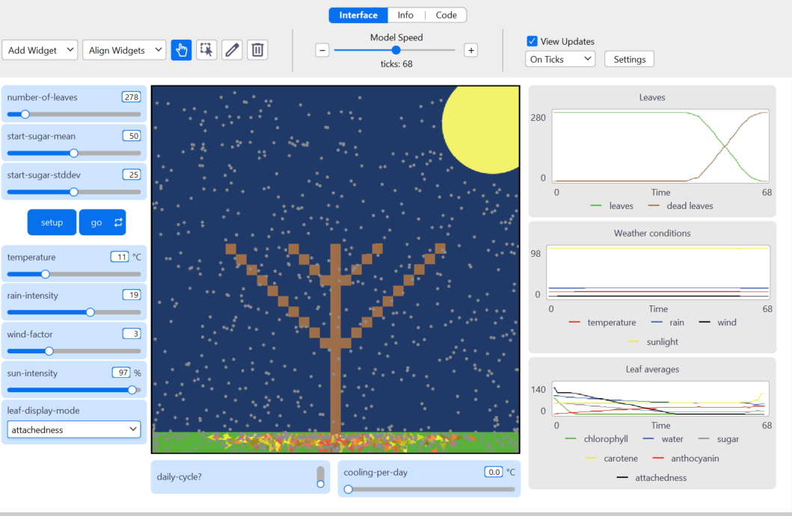
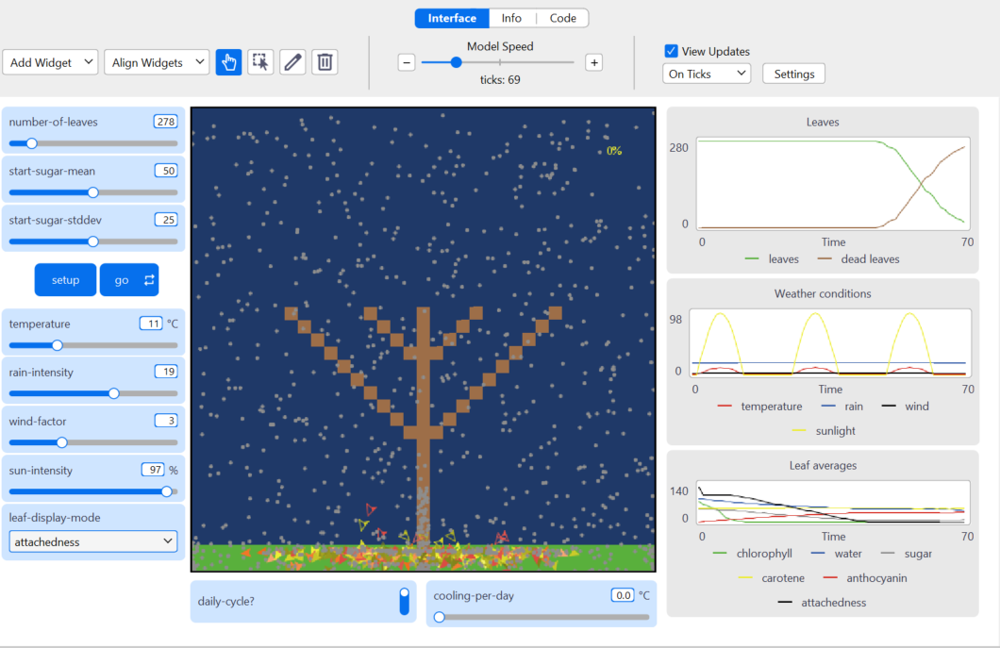
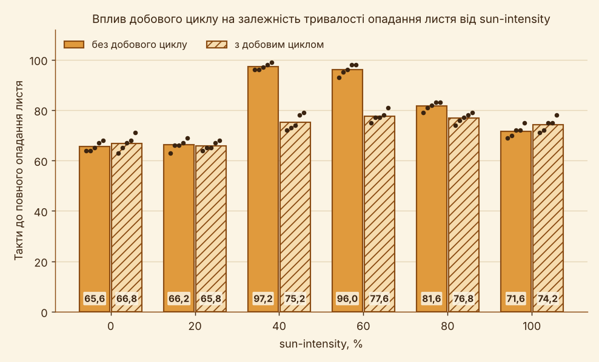

## Комп'ютерні системи імітаційного моделювання
## СПм-25-2, **Роскошний Владислав Русланович**
### Лабораторна робота №**2**. Редагування імітаційних моделей у середовищі NetLogo

<br>

### Варіант 11, модель у середовищі NetLogo:
[Autumn](https://www.netlogoweb.org/launch#http://www.netlogoweb.org/assets/modelslib/Sample%20Models/Biology/Autumn.nlogo)

<br>

### Внесені зміни у вихідну логіку моделі, за варіантом:

**Добові цикли сонячного світла і температури** - у вихідній моделі інтенсивність світла (`sun-intensity`) і температура (`temperature`) весь час дорівнюють значенням слайдерів. Додано перемикач `daily-cycle?`. Коли він увімкнений, слайдер `sun-intensity` задає освітленість опівдні, а поточна інтенсивність змінюється протягом доби за синусоїдою: перша половина доби - день (від 0 до максимуму і назад), друга - ніч, коли світла немає. Температура вночі нижча на `night-cooling` градусів, а вдень зростає разом зі світлом. Поточні значення зберігаються у нових змінних `sun-now` та `temp-now`, і саме їх тепер використовують процедури листя (`adjust-water`, `adjust-chlorophyll`, `adjust-sugar`, `change-color`, `show-intensity`) та графіки Weather conditions. Якщо перемикач вимкнений, `sun-now` і `temp-now` дорівнюють значенням слайдерів, тобто модель поводиться як раніше.

Нова процедура, що викликається в `setup` і на початку кожного такту в `go`:
```netlogo
to update-daily-cycle [ tick-number ]
  let days tick-number / day-length
  let base-temp temperature - cooling-per-day * days
  ifelse daily-cycle? [
    let daylight max (list 0 sin (360 * ((tick-number mod day-length) / day-length)))
    set sun-now sun-intensity * daylight
    set temp-now base-temp - night-cooling * (1 - daylight)
  ] [
    set sun-now sun-intensity
    set temp-now base-temp
  ]
end
```
Приклад заміни у процедурах листя (`adjust-chlorophyll`):
```netlogo
;; було
if sun-intensity > 75 [
  set chlorophyll chlorophyll - (.5 * (sun-intensity - 75))
]
;; стало
if sun-now > 75 [
  set chlorophyll chlorophyll - (.5 * (sun-now - 75))
]
```
Аналогічно `temperature` замінено на `temp-now` в `adjust-water`, `adjust-chlorophyll` та `change-color`, а `sun-intensity` на `sun-now` в `adjust-chlorophyll`, `adjust-sugar`, `show-intensity`. На графіках замість `plot temperature` та `plot sun-intensity` тепер `plot temp-now` та `plot sun-now`. Підпис сонця показує округлене `sun-now` (`set label word (round sun-now) "%"`).

**Тривалість модельної доби як внутрішній параметр** - змінну `day-length` додано до глобальних змінних і задано в `setup` без слайдера, як внутрішній параметр моделі:
```netlogo
globals [
  ;; ... існуючі змінні ...
  day-length         ;; number of ticks in one model day
  night-cooling      ;; how many degrees colder the night is than the daytime temperature
  sun-now            ;; current sun intensity
  temp-now           ;; current temperature
]

to setup
  ;; ... існуючий код ...
  set evaporation-temp 30
  set day-length 24
  set night-cooling 10
  update-daily-cycle 0
  ;; ... існуючий код ...
end
```
Одна модельна доба дорівнює 24 тактам (`day-length`), на початку симуляції (такт 0) світанок.

<br>

### Внесені зміни у вихідну логіку моделі, на власний розсуд:

**Сезонне похолодання.** Додано слайдер `cooling-per-day` (від 0 до 5 °C, крок 0,5, за замовчуванням 0). Денна температура зменшується на це значення з кожною модельною добою: у `update-daily-cycle` вона обчислюється як `base-temp = temperature - cooling-per-day * days`, де `days = ticks / day-length`. Це відображає поступове настання осені. При значенні 0 (за замовчуванням) зміна ні на що не впливає і логіка вихідної моделі не порушується. Працює незалежно від `daily-cycle?`. Вплив цього слайдера на показники в експерименті нижче не досліджувався (у всіх прогонах `cooling-per-day` = 0).

На рис. 1 і 2 показано інтерфейс моделі з двома новими елементами (`daily-cycle?` та `cooling-per-day`) під полем моделі.

  
*Рис. 1. Модель з вимкненим `daily-cycle?` (такт 68): сонце постійне, на графіку Weather conditions лінії світла і температури горизонтальні.*

  
*Рис. 2. Модель з увімкненим `daily-cycle?` (такт 69): на графіку Weather conditions видно три добові цикли світла (по 24 такти) і відповідні коливання температури. На момент знімка настала ніч, підпис сонця показує 0%.*

Фінальний код моделі та її інтерфейс доступні за посиланням: [Autumn.nlogox](Autumn.nlogox).

<br>

## Обчислювальний експеримент
### 1. Вплив добового циклу на залежність тривалості опадання листя від інтенсивності світла
Досліджується, як зміна логіки (добові цикли світла і температури) вплинула на залежність показника від параметра **sun-intensity**. Експеримент `lw2_cycle` виконано засобами BehaviorSpace: sun-intensity = 0, 20, 40, 60, 80, 100 %, перемикач `daily-cycle?` вимкнений і увімкнений, по 5 повторів, усього 60 симуляцій, ліміт 200 тактів. Результати збережено у файлі `e1.csv`.  
Інші керуючі параметри мають такі значення:
- **number-of-leaves**: 278
- **start-sugar-mean**: 50
- **start-sugar-stddev**: 25
- **temperature**: 11
- **rain-intensity**: 19
- **wind-factor**: 3
- **cooling-per-day**: 0

**Вибір показника.** У метриці експерименту записано кількість опалого листя (count dead-leaves), але вона у всіх 60 прогонах дорівнює 278, бо прогін завершується, коли на дереві не лишається живого листя (у `go` є умова `if not any? leaves [ stop ]`). Тому, як і в лабораторній роботі 1, як показник використано **кількість тактів до завершення прогону** (стовпець [step] у CSV), тобто тривалість опадання всього листя. Ліміт 200 тактів не досягався в жодному прогоні (максимум 99 такт).

| sun-intensity, % | Без циклу: середнє | Без циклу: ст. відхил. | Без циклу: мін - макс | З циклом: середнє | З циклом: ст. відхил. | З циклом: мін - макс |
|---|---|---|---|---|---|---|
| 0 | 65,6 | 1,8 | 64 - 68 | 66,8 | 3,0 | 63 - 71 |
| 20 | 66,2 | 2,2 | 63 - 69 | 65,8 | 1,6 | 64 - 68 |
| 40 | 97,2 | 1,3 | 96 - 99 | 75,2 | 3,1 | 72 - 79 |
| 60 | 96,0 | 2,1 | 93 - 98 | 77,6 | 2,2 | 75 - 81 |
| 80 | 81,6 | 1,7 | 79 - 83 | 76,8 | 1,9 | 74 - 79 |
| 100 | 71,6 | 2,3 | 69 - 75 | 74,2 | 2,8 | 71 - 78 |

  
*Рис. 3. Середня кількість тактів до повного опадання листя (стовпці) та результати окремих прогонів (точки) для вимкненого та увімкненого `daily-cycle?`.*

**Без добового циклу** залежність така сама немонотонна, як у лабораторній роботі 1: при 0 і 20 % листя опадає за 65,6 та 66,2 такту, при 40 % тривалість зростає до 97,2, при 60 % становить 96,0, далі зменшується до 81,6 при 80 % і 71,6 при 100 %.

**З добовим циклом** при 0 і 20 % результат майже не змінюється (66,8 та 65,8 такту), але «горб» при 40-60 % зникає: середнє становить 75,2 при 40 %, 77,6 при 60 %, 76,8 при 80 % і 74,2 при 100 %, тобто залежність від sun-intensity у діапазоні 40-100 % стала майже пласкою (від 74,2 до 77,6 такту). При 40 % і 60 % результати двох режимів не перетинаються (без циклу 96 - 99 та 93 - 98, з циклом 72 - 79 та 75 - 81), тобто листя з добовим циклом опадає приблизно на 22 та 18 такти швидше. При 100 % з циклом тривалість навіть трохи більша (74,2 проти 71,6), але діапазони значень перекриваються (71 - 78 та 69 - 75), тому цю різницю за 5 повторів стверджувати не можна.

**Можливе пояснення за кодом моделі.** У `adjust-sugar` листок збільшує `attachedness` на 5 і виробляє цукор лише тоді, коли `sun-now` > 20. Без циклу це виконується при кожному такті, якщо sun-intensity > 20, тому при 40-60 % листя довго утримується на дереві. З добовим циклом `sun-now` перевищує 20 лише частину доби: за формулою `update-daily-cycle` для 24 тактів це 0 тактів при sun-intensity 0 і 20 %, 7 при 40 %, 9 при 60 %, 11 при 80 % та 100 %. Вночі `sun-now` = 0, і листок не нарощує `attachedness`. Це збігається з тим, що при 0 і 20 % (де в обох режимах умова не виконується) результати однакові. Цю причину окремо не перевіряли (наприклад, експериментом із зміною `night-cooling`), тому вона залишається припущенням.

<br>

### Висновки:
У модель Autumn додано добові цикли світла і температури (перемикач `daily-cycle?`, внутрішні параметри `day-length` = 24 та `night-cooling` = 10) і власну зміну - сезонне похолодання (слайдер `cooling-per-day`). За вимкненого перемикача модель працює як вихідна. В експерименті з 60 симуляцій показано, що добові цикли суттєво змінили залежність тривалості опадання листя від sun-intensity: «горб» при 40-60 % (97,2 і 96,0 такту) зник, і з циклом тривалість у діапазоні 40-100 % лежить у межах 74,2 - 77,6 такту. При 0 і 20 % зміни логіки результат не змінила. Вплив слайдера `cooling-per-day` на показники не досліджувався. Через малу кількість повторів (5) отримані оцінки наближені.
