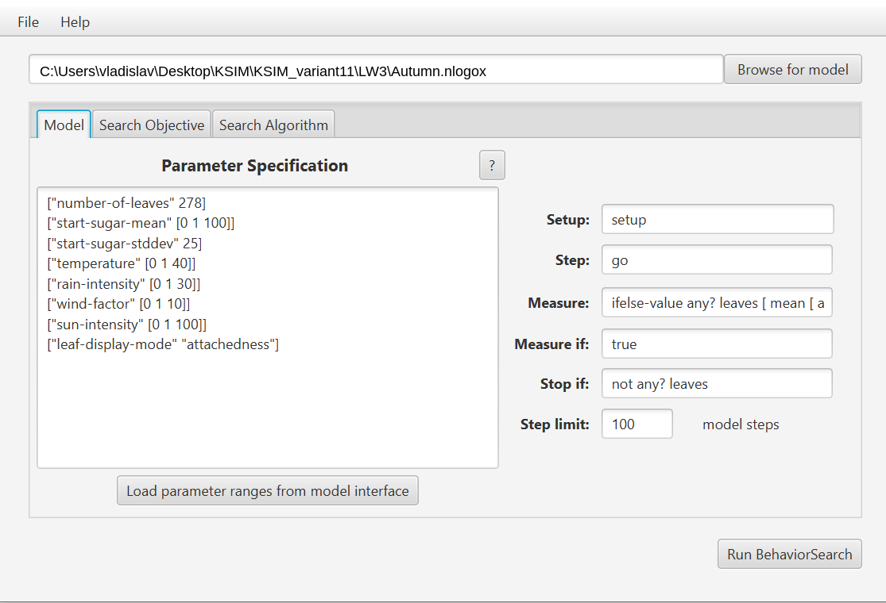
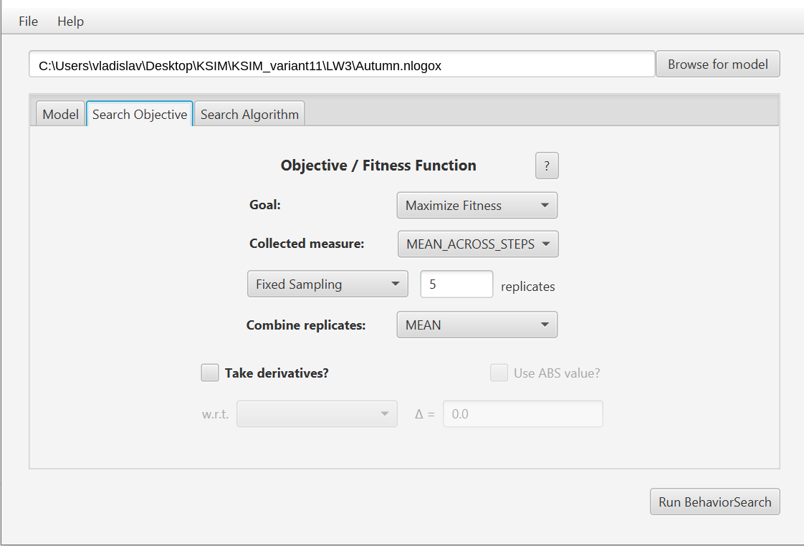
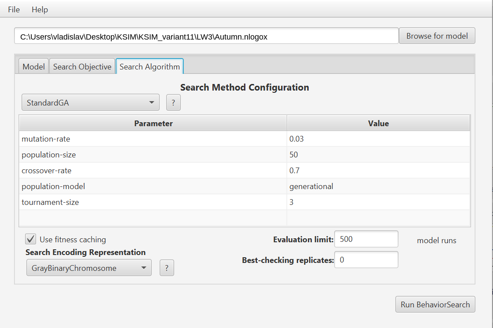
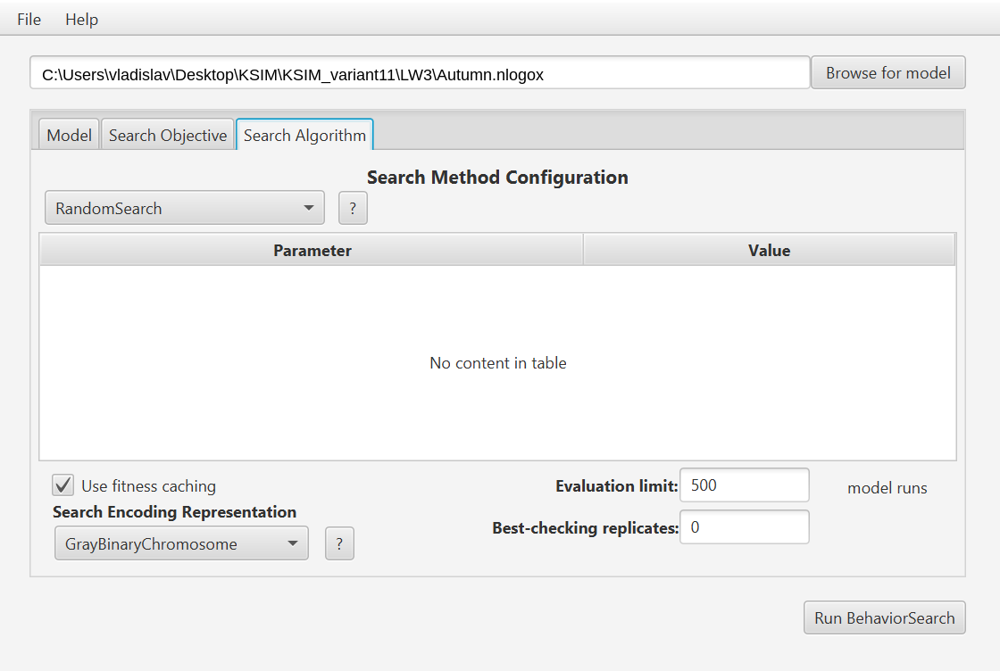
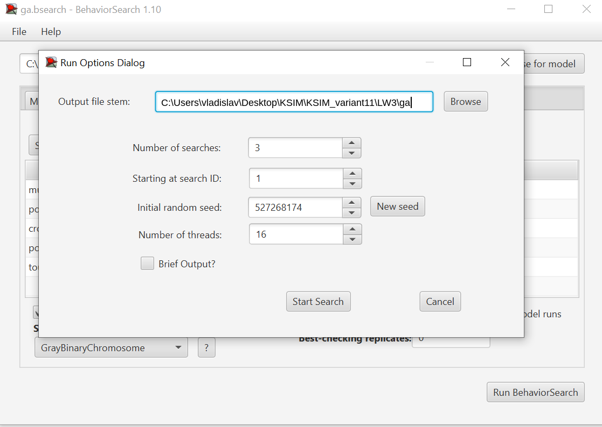
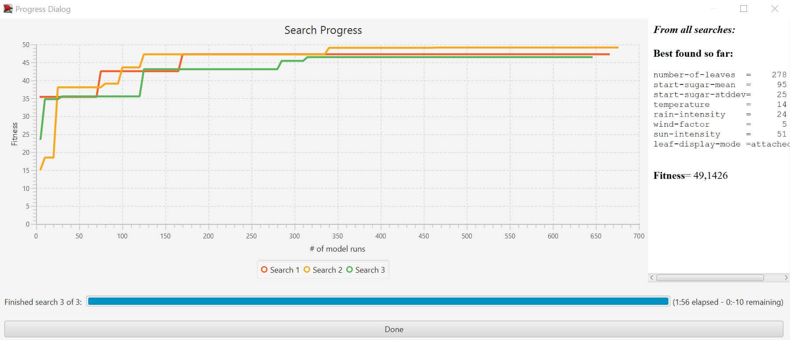
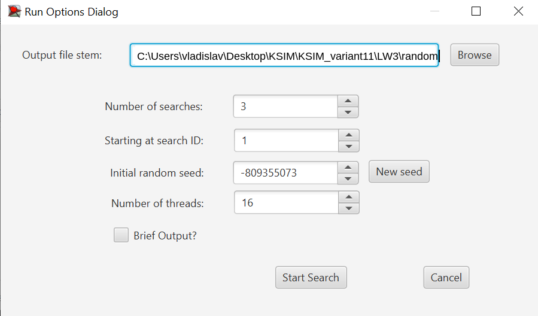
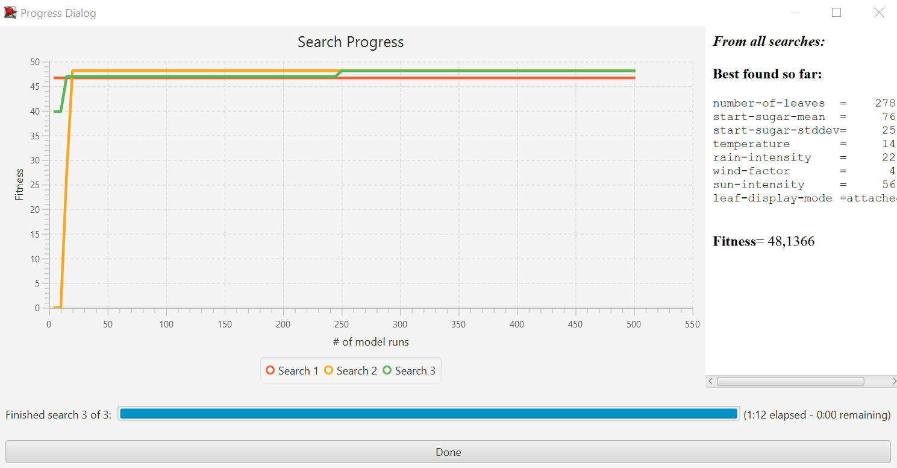
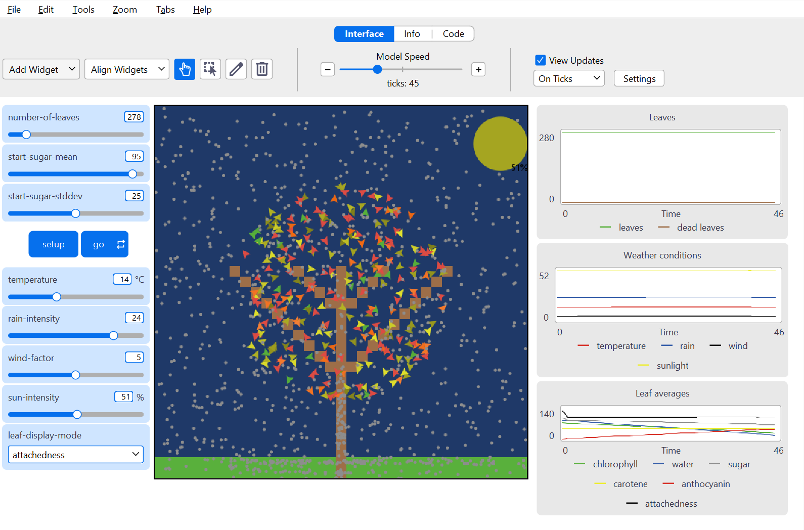

## Комп'ютерні системи імітаційного моделювання
## СПм-25-2, **Роскошний Владислав Русланович**
### Лабораторна робота №**3**. Використання засобів обчислювального інтелекту для оптимізації імітаційних моделей

 

### Варіант 11, модель у середовищі NetLogo:
[Autumn](https://www.netlogoweb.org/launch#http://www.netlogoweb.org/assets/modelslib/Sample%20Models/Biology/Autumn.nlogo)

 

#### Вербальний опис моделі:
Опис моделі, її параметрів та показників наведено в [першій лабораторній роботі](../LW1/LW1.md). У цій роботі використано базову версію моделі, без змін з другої лабораторної роботи.

 

### Налаштування середовища BehaviorSearch:

**Обрана модель**: [Autumn.nlogox](Autumn.nlogox) з цього каталогу (версія NetLogo 7.0.4, BehaviorSearch 1.10).

**Параметри моделі** (вкладка Model):
<pre>
["number-of-leaves" 278]
["start-sugar-mean" [0 1 100]]
["start-sugar-stddev" 25]
["temperature" [0 1 40]]
["rain-intensity" [0 1 30]]
["wind-factor" [0 1 10]]
["sun-intensity" [0 1 100]]
["leaf-display-mode" "attachedness"]
</pre>
Діапазони відповідають слайдерам інтерфейсу моделі. Параметри number-of-leaves (278), start-sugar-stddev (25) та leaf-display-mode (attachedness) зафіксовано на значеннях за замовчуванням, щоб скоротити простір пошуку і час розрахунку (режим відображення лише змінює форму листків і на показники не впливає). Змінюються п'ять параметрів: start-sugar-mean, temperature, rain-intensity, wind-factor та sun-intensity.

Використовувана **міра**:
<pre>
ifelse-value any? leaves [ mean [ anthocyanin ] of leaves ] [ 0 ]
</pre>
Міра - середній вміст антоціану (речовини, що забарвлює листя в червоний колір) у листків, що ще залишилися на дереві. Вона обрана тому, що в моделі Autumn антоціан визначає «осінній» червоний колір листя, тобто мета підбору - параметри, при яких листя найчервонішим. Умова `ifelse-value any? leaves` потрібна, бо коли всі листки опали, `mean` від порожньої множини дав би помилку, тому в цьому випадку повертається 0. Інші параметри вкладки: Setup - `setup`, Step - `go`, Measure if - `true`, Stop if - `not any? leaves` (модель сама зупиняється, коли листя не лишилося), Step limit - 100 тактів.  

**Налаштування цільової функції** (вкладка Search Objective):  
Мета - **максимізація** середнього вмісту антоціану (Goal: Maximize Fitness). Collected measure: **MEAN_ACROSS_STEPS**, тобто береться середнє значення міри за всі такти прогону. Щоб зменшити вплив випадковості в самій моделі, кожен варіант параметрів перевіряється **5 разів** (Fixed Sampling, 5 replicates), результат - **середнє арифметичне** (Combine replicates: MEAN).  

**Налаштування алгоритму пошуку** (вкладка Search Algorithm):  
Для обох алгоритмів Evaluation limit = **500**, кодування - GrayBinaryChromosome, Use fitness caching увімкнено, Best-checking replicates = 0. Налаштування збережено у файлах [ga.bsearch](ga.bsearch) та [random.bsearch](random.bsearch).
- **StandardGA** (простий генетичний алгоритм) - параметри за замовчуванням: mutation-rate 0,03; population-size 50; crossover-rate 0,7; population-model generational; tournament-size 3.
- **RandomSearch** (випадковий пошук) - власних параметрів не має.

Вкладка Search Algorithm для генетичного алгоритму:  

Вкладка Search Algorithm для випадкового пошуку:  

 

### Результати використання BehaviorSearch:
Кожен алгоритм запускався тричі (Number of searches: 3). Дані взято з файлів `ga.finalBests.csv` та `random.finalBests.csv`, повні історії пошуку - у решті CSV-файлів цього каталогу.

Діалогове вікно запуску пошуку генетичним алгоритмом:  

Результат пошуку параметрів за допомогою **генетичного алгоритму**:  

| Пошук | start-sugar-mean | temperature | rain-intensity | wind-factor | sun-intensity | Fitness | Запусків моделі до кінця пошуку |
|---|---|---|---|---|---|---|---|
| 1 | 60 | 14 | 21 | 4 | 52 | 47,26 | 665 |
| 2 | 95 | 14 | 24 | 5 | 51 | 49,14 | 675 |
| 3 | 83 | 16 | 3 | 3 | 58 | 46,46 | 645 |

Діалогове вікно запуску випадкового пошуку:  

Результат **випадкового пошуку**:  

| Пошук | start-sugar-mean | temperature | rain-intensity | wind-factor | sun-intensity | Fitness | Запусків моделі до кінця пошуку |
|---|---|---|---|---|---|---|---|
| 1 | 50 | 17 | 10 | 3 | 45 | 46,68 | 500 |
| 2 | 76 | 14 | 22 | 4 | 56 | 48,14 | 500 |
| 3 | 92 | 16 | 30 | 3 | 71 | 48,09 | 500 |

### Порівняння алгоритмів:
Найкращий результат дав генетичний алгоритм (пошук 2): fitness 49,14 при start-sugar-mean 95, temperature 14, rain-intensity 24, wind-factor 5, sun-intensity 51. У випадкового пошуку найкращий результат 48,14 (start-sugar-mean 76, temperature 14, rain-intensity 22, wind-factor 4, sun-intensity 56), тобто приблизно на 1 одиницю (близько 2 %) нижче.

Однак у середньому за трьома пошуками алгоритми не відрізняються: для ГА середній найкращий fitness дорівнює 47,62 (від 46,46 до 49,14), для випадкового пошуку 47,64 (від 46,68 до 48,14). Діапазони результатів перекриваються, тому за трьома пошуками стверджувати, що один з алгоритмів кращий, не можна. Обидва алгоритми знайшли схожу область параметрів: temperature 14-17, wind-factor 3-5, sun-intensity 45-71 (серед найкращих результатів усіх шести пошуків), тобто помірні температура, вітер і освітленість.

Швидкість: ГА збільшував результат поступово. Значення fitness від 45 він досягнув на 170, 125 та 285-му запусках моделі (за пошуками 1, 2 і 3). Випадковий пошук досяг 45 на 5, 20 та 15-му запусках, тобто швидше, а потім майже не покращував результат (останнє покращення в пошуку 3 відбулося на 250-му запуску). За часом три пошуки ГА зайняли 1:56, випадкового пошуку - 1:12 (за вікнами прогресу). Причому у ГА остання перевірка припала на 645-675-й запуск, тобто трохи більше за ліміт 500, у випадкового пошуку рівно 500. Швидке досягнення схожого результату випадковим пошуком може означати, що в просторі параметрів для цієї цілі є широка область з близькими значеннями fitness, але це припущення окремо не перевірялось.

### Перевірка знайдених параметрів у NetLogo:
У NetLogo виставлено параметри, знайдені генетичним алгоритмом (пошук 2): start-sugar-mean 95, temperature 14, rain-intensity 24, wind-factor 5, sun-intensity 51, решта параметрів за замовчуванням. Модель працює коректно: на 45-му такті листя змінило колір із зеленого на жовтий, оранжевий та червоний, при цьому всі листки ще на дереві (на графіку Leaves лінія leaves лишається на 278, опалого листя немає), а на графіку Leaf averages видно зростання антоціану.  
  
*Рис. 1. Модель Autumn із параметрами, знайденими генетичним алгоритмом (такт 45).*
